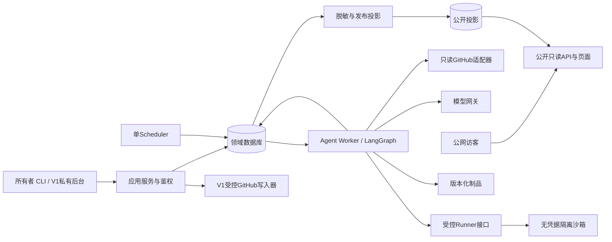
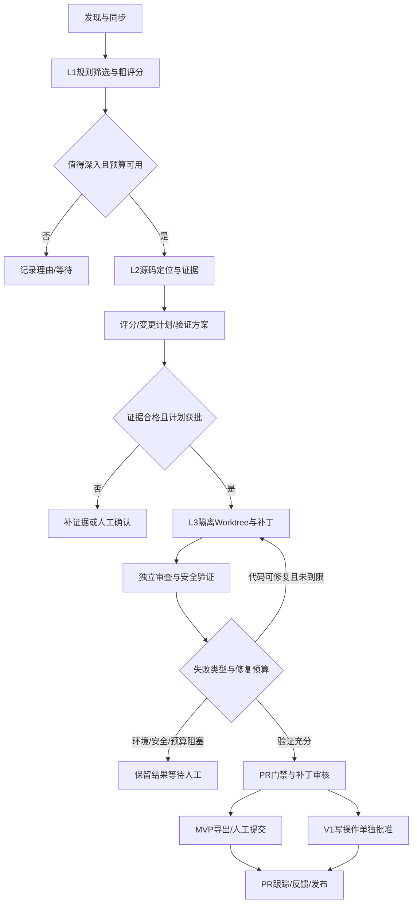

# OpenSource Scout Agent 系统架构

版本：1.0｜2026-10-29｜设计状态：待实现。

本文件落实[PRD](产品需求文档.md)与[31项决策](设计决策记录.md)。原决策约束使用“必须”；框架、字段和默认值属于本次实施建议，变更时须同步路线图与验收。不得把设计图视为已运行的工程。

## 1. 技术基线与部署形态

| 层 | MVP | V1 |
|---|---|---|
| 应用 | 建议Python + FastAPI + Pydantic；CLI复用应用服务 | 保留相同领域接口，增加私有管理后台 |
| 编排 | LangGraph StateGraph、持久化Checkpoint、确定性路由 | 节点模型路由，按评测增加专职节点 |
| 持久化 | SQLite + 建议SQLAlchemy/Alembic；本地文件制品 | PostgreSQL + pgvector；制品存储接口不变 |
| 调度 | APScheduler单Scheduler；数据库任务表；单Worker | Redis投递 + 多Worker；数据库仍为任务事实源 |
| 前端 | 建议轻量服务端页面，历史只读报告优先 | 可选React/TypeScript后台与SSE；不是原决策指定框架 |
| 执行 | 独立受控Sandbox Runner、可信Python/Java模板 | 更多可信模板及分级环境适配 |
| 开发/生产 | Windows + Docker Desktop / Linux + Docker Compose | 按实际并发扩容，暂不引入Kubernetes |

应用的Python版本、Java模板的JDK/Maven版本及库版本由实施时兼容性验证后锁定，禁止使用浮动latest作为复现标识。Web/API、Scheduler、Worker是职责边界；MVP可使用同一镜像不同入口。SQLite文件位于同机持久卷，禁止跨主机共享或网络文件系统多写。

图中的Worker读取数据库表示领取持久化任务，不是让数据库主动调度。V1 Redis只负责唤醒/投递task_id，不携带密钥或替代租约检查。

## 2. 组件职责与禁止跨界

| 组件 | 输入/输出 | 边界 |
|---|---|---|
| Discovery | 画像、搜索游标 → 项目候选 | 只调用只读工具；不执行代码 |
| GitHub Adapter | 仓库ID、Issue/PR、Commit → 带时间戳快照 | 分页、限流、ETag、重命名/删除处理；Token不进入模型 |
| Scoring Engine | 特征、规则版本、LLM结构化判断 → 评分 | 不自行放宽证据与安全门禁 |
| Workflow | 任务快照 → 节点状态与制品引用 | 路由、预算、审批中断由代码控制；不是自由聊天Agent |
| Repository Workspace | repo+SHA+task_id → 唯一Worktree | 只能操作允许根目录；Worktree不等于安全沙箱 |
| Model Gateway | 模板、脱敏上下文、路由 → 校验后的输出 | 配额、超时、usage、成本；不拥有任意Shell或GitHub写权限 |
| Sandbox Runner | 可信模板、制品、参数 → 验证报告 | 不能访问应用库、生产卷、Docker socket或密钥 |
| Independent Reviewer | 原计划、冻结Diff、证据、测试 → 审查项 | 与生成节点分离上下文；可用同模型但不声称统计独立 |
| Gate Engine | 审查、远端状态、必要检查 → 分级门禁 | 确定性硬规则；LLM无最终批准权 |
| Approval Service | 操作者、目标内容哈希 → 审批记录 | 区分开发计划、敏感范围、补丁审核、远端写入和公开发布 |
| Publication Projector | 内部事实、白名单规则、发布批准 → 脱敏投影 | 不公开原始日志/Prompt；公开接口不能联表回查内部载荷 |
| Feedback/Memory | 外部评论与结果 → 有来源经验 | 经验是参考，不能升级为系统指令或权限 |

建议目录：app/domain、application、adapters/github、adapters/llm、workflow、worker、scheduler、runner_client、api、public_projection；runner/为执行控制面；migrations/、tests/、evals/、docs/分别管理迁移、测试、评测和文档。

## 3. 工作流与节点契约

专职角色是明确输入输出的节点，MVP无需分别部署多个Agent服务。搜索、状态更新、去重、门禁判定应使用普通代码。L1可以少量调用模型摘要，但先应用廉价规则；L2只拉取相关源码，限制文件数与上下文；L3生成目标范围补丁。不得整仓库无界塞入模型。

GraphState至少包含schema_version、task_id、opportunity_id、repo_id、base_sha、config_snapshot_id、analysis_stage、evidence_refs、plan_id/hash、patch_version/ref/hash、validation_refs、review_ref、budget_reservation、retry_counters、next_action。只存引用与必要结构化信息，不把密钥或完整仓库写入Checkpoint。

每节点契约：校验输入版本和租约 → 检查预算及取消 → 执行受控工具 → 校验结构化输出 → 写不可变制品 → 原子提交领域状态/节点事件/Checkpoint指针。无法跨存储事务时使用pending制品记录和恢复对账；孤立制品清理前核对引用。LangGraph自己的Checkpointer与领域表双写不得默认原子，适配层通过node_commit_key和已提交节点标记对账，崩溃后优先核对已存在输出，不盲目重复副作用。

人工确认在持久化中断点完成，不以进程内等待保存。恢复必须检查计划哈希、基线和批准有效性。配置/Prompt/模型路由改变不自动重写运行任务；显式创建新修订任务后才使用新快照。

## 4. 三层状态机

### 4.1 贡献机会

| 状态 | 合法进入条件 | 后续 |
|---|---|---|
| DISCOVERED | 首次去重入库 | ANALYZING、ABANDONED |
| ANALYZING | 启动L1/L2 | READY_FOR_APPROVAL；证据不足保留并附原因 |
| READY_FOR_APPROVAL | 证据与计划已准备 | 批准后IMPLEMENTING；驳回后ANALYZING或ABANDONED |
| IMPLEMENTING | 有效计划批准且任务执行 | REVIEW_PENDING；失败不自动放弃机会 |
| REVIEW_PENDING | 补丁、审查与验证报告齐备，包括阻塞说明 | APPROVED、IMPLEMENTING、ABANDONED |
| APPROVED | 人工认可具体补丁，门禁无硬阻断 | 人工回填或受控写入成功后PR_TRACKING |
| PR_TRACKING | 可核实的远端PR已关联 | MERGED、CLOSED_UNMERGED；维护者要求改动时可新开IMPLEMENTING任务 |
| MERGED | GitHub确认merged=true | 归档、反馈 |
| CLOSED_UNMERGED | 远端关闭且未合并 | 记录原因，重开需显式动作 |
| ABANDONED | 所有者放弃并记录理由 | 重新启用需显式动作及重新验证 |

needs_revalidation、blocked_reason、paused_reason是正交字段，不另用STALE覆盖阶段。远端Commit/相关源码/Issue契约发生变化即设置needs_revalidation，并冻结审核/写入；重新分析及验证后清除。批准记录保留但变为invalidated。证据不足不能假装READY_FOR_APPROVAL。

### 4.2 执行任务

QUEUED → RUNNING → SUCCEEDED；RUNNING也可进入RETRY_WAIT、WAITING_APPROVAL、PAUSED_BUDGET、FAILED、CANCELLED。RETRY_WAIT到期重新入队；批准或预算恢复后以新租约恢复。WAITING_APPROVAL与PAUSED_BUDGET释放租约，不占Worker。

FAILED表示某次执行终结，不等于机会失去价值；显式重试创建关联的新attempt或新任务修订，不能覆盖历史。取消请求设置cancel_requested_at，节点边界和长命令轮询检查；停止进程后记录CANCELLED，未确认停止前不得宣称资源已释放。恢复禁止旧租约提交。

### 4.3 外部GitHub事实

Issue：OPEN/CLOSED/UNKNOWN；PR：OPEN/CLOSED/MERGED/UNKNOWN；Review与CI独立保存。每条含fetched_at、source_url、head_sha、etag。网络失败保留上一事实并标记stale/last_error。只有远端事实可确认合并。Issue关闭不证明本工具补丁已合并。

## 5. 数据模型

全部时间用UTC保存、展示时转本地时区；调度配置显式timezone，默认Asia/Shanghai。ID建议UUID字符串以利跨库迁移；金额用整数最小计费单位或Decimal，禁用浮点直接记账；JSON字段版本化。MVP只迁移必须的表，V1表不得成为MVP启动依赖。

| 表 / 阶段 | 核心字段 | 约束与关联 |
|---|---|---|
| repositories / MVP | id, github_id, full_name, url, default_branch, observed_sha, language, activity, pool_status, reason, last_scan_at | github_id唯一；名称可变；禁止仅按名称去重 |
| sync_cursors / MVP | repo_id, resource, cursor, since_at, etag, completed_at | repo_id+resource唯一；事务提交后才前移 |
| github_items / MVP | id, repo_id, github_node_id, number, kind, title, body_ref, state, updated_at, fetched_at, head_sha | repo_id+number唯一，kind=ISSUE/PR；保留历史快照引用 |
| opportunities / MVP | id, repo_id, issue_id?, kind, fingerprint, lifecycle, needs_revalidation, blocked_reason, latest_analysis_id | issue型按repo+issue关联；源码型按稳定规则+符号/路径指纹，版本不直接制造新机会 |
| config_snapshots / MVP | id, schema_version, profile, filters, scoring, budgets, model_routes, schedule, prompt_versions, content_hash, created_at | 内容不可变；不保存明文secret，只保存secret_ref |
| analyses / MVP | id, opportunity_id, base_sha, stage, config_id, report_ref, created_at | 同一机会多版本；来源变化生成新版本 |
| evidence / MVP | id, analysis_id, level, type, source_url, path, line_start/end, blob_sha, observed_at, reproduction_ref | 行号必须对应blob；缺失来源不允许E2/E3 |
| scores / MVP | id, opportunity_id, analysis_id, scoring_version, components, missing, confidence, total | 重评分追加记录，不覆盖原分 |
| change_plans / MVP | id, opportunity_id, base_sha, allowed_paths, sensitive_paths, intended_behavior, test_plan, risk, plan_hash | 修订不可变；超出范围重新确认 |
| tasks / MVP | id, kind, opportunity_id?, idempotency_key, status, priority, run_after, config_id, lease_owner, lease_until, lease_generation, attempts, cancel_requested_at | idempotency_key唯一；状态/领取条件建索引 |
| task_attempts / MVP | id, task_id, attempt_no, worker_id, lease_generation, started_at, ended_at, error_type, checkpoint_id | task+attempt_no唯一；保留每次失败 |
| checkpoints / MVP | id, task_id, node, node_commit_key, schema_version, graph_version, state_ref, output_hash, created_at | node_commit_key唯一；恢复前验证SHA/制品/图版本 |
| patches / MVP | id, opportunity_id, task_id, version, base_sha, worktree_id, diff_ref, diff_hash, files, risk | opportunity+version唯一；制品不可变；不得以路径指向任意宿主机文件 |
| validations / MVP | id, patch_id, level, check_type, required, command_template, image_digest, result, exit_code, logs_ref, baseline_result, duration | 同一patch多检查；result不由exit_code单字段推断 |
| reviews_gates / MVP | id, patch_id, reviewer_version, findings, gate, reasons, github_snapshot_id, evaluated_at | 记录每次评估；PASS不等于批准 |
| approvals / MVP | id, actor, type, target_id, base_sha, plan_hash, diff_hash?, payload_hash, decision, expires_at, invalidated_at | type区分PLAN/PATCH/SCOPE/WRITE/PUBLISH；批准不能跨内容复用 |
| events / MVP | id, task_id, sequence, node, type, started/ended_at, status, summary, tool_ref, artifact_refs | task+sequence唯一；内部append-only；原始secret不允许落日志 |
| artifacts / MVP | id, storage_key, sha256, media_type, size, visibility, scan_status, created_at | storage_key非任意路径；下载做鉴权；哈希校验 |
| publications / MVP | id, source_run_id, revision, sanitized_payload, redaction_version, approved_by, published_at, revoked_at | 仅审核通过投影可公开；公开UUID不能暴露内部枚举ID |
| usage_ledger / MVP | id, task_id, call_id, provider, model, input/output_tokens?, estimated, pricing_version, cost?, reservation_id | call_id唯一；未知为NULL；预留与结算有状态 |
| pr_links_feedback / MVP | opportunity_id, pr_node_id, url, head_sha, state, fetched_at, raw_feedback_ref, author, source_time | PR事实可核实；评论属于不可信输入 |
| schedules / MVP | id, kind, timezone, expression, enabled, config_id, last_tick | tick唯一键去重；MVP允许文件配置同步成版本 |
| memories / V1 | id, layer, repo_id?, claim, sources, confidence, applicable_sha/range, valid_until, revoked_at, reviewed_by | RAW/REPO/GENERAL分层；过期/撤销过滤 |
| embeddings / V1 | id, memory_or_analysis_id, model_version, dimensions, content_hash, vector | embedding模型变更不得混查不兼容向量 |
| outbox_write_actions / V1 | id, task_id, action_type, target, payload_hash, approval_id, remote_id?, status, dedupe_key | dedupe_key唯一；数据库事务outbox；结果不明进入UNKNOWN |
| eval_cases/results / MVP起 | case_id, split, repo/issue, frozen_sha, labels, evidence_refs / run_id, config_id, metrics, judge | 建议MVP用版本化JSONL+报告，V1入库；不得混淆开发与留出集 |

关系：Repository 1:N GitHubItem/Opportunity；Opportunity 1:N Analysis/Plan/Patch/Task/Score；Patch 1:N Validation/Gate/Approval；Task 1:N Attempt/Checkpoint/Event/Usage；Publication引用一个真实运行的审核后投影。删除默认逻辑删除，禁止级联抹去审批和贡献证据。

## 6. 调度、幂等、租约与恢复

### 6.1 投递与领取

APScheduler只生成持久化任务，不在调度进程内执行LLM或构建。每天增量、每周高价值复核、每月项目池重评为可调整默认频率，具体时刻配置而非写死；停机错过多个tick时合并为一次补扫，记录合并范围。

建议幂等键：扫描=repo_id+resource+schedule_tick；分析=opportunity_id+input_snapshot_hash+config_hash+stage；补丁=opportunity_id+plan_hash+base_sha+revision。显式重新生成须增加revision。远端写入=action_type+target_repo+payload_hash。

SQLite使用短BEGIN IMMEDIATE事务领取并条件更新租约；配置busy_timeout、WAL并对锁冲突有限退避。不能先SELECT后无条件UPDATE。V1 Postgres可用行锁/SKIP LOCKED及条件更新。Redis投递是至少一次；Worker必须按DB状态领取。

租约建议120秒、每30秒续租，仅为初始参数；长操作也要独立续租。领取时递增lease_generation，续租、Checkpoint、状态和输出提交均带owner+generation+有效期条件。租约过期旧Worker即使还运行也不能提交。Runner job同样绑定generation；新执行启动前取消/隔离旧作业，产物只接受当前代。

### 6.2 错误分类

| 错误 | 处理 |
|---|---|
| GitHub限流 | 按Retry-After/reset_at，暂停相关额度；不把限流误作不存在 |
| 网络/5xx/clone失败 | 有限指数退避+抖动；建议最多3次；每错误类型可配置 |
| LLM超时 | 对账并标记可能重复计费；保守记预算，有限重试 |
| 结构化输出非法 | schema拒绝；一次受预算约束格式修复后再判断重试 |
| 代码测试失败 | 进入代码修复计数，默认最多2次；不是基础设施重试 |
| 环境不可用 | ENVIRONMENT_UNAVAILABLE，生成环境说明；不无界修环境 |
| 安全策略拒绝 | 硬阻断，禁止通过模型换命令绕过 |
| 补丁基线过期 | needs_revalidation；重新分析、重做验证和批准 |
| 预算用尽 | PAUSED_BUDGET；记录恢复条件，人工/新预算周期后重新领取 |
| Worker崩溃 | 租约过期后新attempt从有效Checkpoint恢复 |

Checkpoint有效性包括输入SHA、配置、图schema版本、制品哈希和批准范围。复用缓存时只读历史证据；GitHub当前状态仍需刷新。无法兼容的图版本不得直接反序列化运行，转人工或从安全阶段重开。

LLM/API不承诺恰好执行一次：可保障领域提交去重，不能保证网络超时无重复计费。外部写入结果UNKNOWN时先查询远端分支/PR标识，无法确认则等待人工，禁止盲目再发。

## 7. 安全执行与权限

### 7.1 信任边界

仓库README、Issue、评论、源码、日志及模型输出全部是不可信数据。它们不能更改系统指令、批准操作、获取secret或选择任意执行命令。工具接口采用类型化参数与允许列表；字符串不得拼接为任意Shell。路径做规范化与根目录验证，阻止绝对路径、../、符号链接逃逸和恶意归档。克隆禁用递归submodule、LFS自动拉取及非必要hooks，按明确策略另行处理。

### 7.2 沙箱最小要求

- 非root、非特权、drop capabilities、no-new-privileges；只读根文件系统，独立临时工作卷；限制CPU、内存、PID、磁盘和墙钟时间。
- 不挂载生产数据、SSH目录、凭据、宿主机根目录或Docker socket；任务之间不共享可写工作卷；可信依赖缓存只读或按任务隔离。
- 默认禁止网络；依赖准备由受控阶段通过允许的镜像源/制品代理完成，随后离线执行。无法准备则标环境不可用；禁止因缺包开放任意出站。
- 内网、云元数据地址、控制面和数据库地址不可达；应用密钥不出现在env、命令行或挂载中。
- 由控制面选择可信镜像digest与命令模板，不直接执行仓库Dockerfile/Compose或CI文件。仓库声明仅用于识别环境建议。
- Sandbox Runner与Web分离。若Runner需要容器管理权限，仅部署在专用执行主机/虚拟机并经窄接口访问；Worker和不可信任务均不得持有宿主容器管理权限。

MVP可在专用Linux执行环境以受限容器实现，但必须实际验证边界。Windows开发不代表云端隔离已验证。T1解析器也应受资源和安全边界约束。没有隔离条件时只提供不执行目标代码的分析，不能降级到宿主机执行。

### 7.3 变更与审批

默认敏感范围含.github/workflows、构建/安装脚本、依赖清单与锁文件、权限/认证代码、迁移、密钥相关路径；项目可扩展。不同风险等级决定所需测试和批准。开发批准绑定plan_hash+base_sha；补丁审核绑定diff_hash；远端写入绑定目标、分支、具体载荷、有效期和相关批准。任意内容变化触发失效。配置里的凭据引用不暴露原值。

MVP使用只读GitHub访问，必要时细粒度PAT；受控写工具为V1。Web会话需强认证、CSRF保护、限速、管理入口网络限制与审计；公开入口的POST请求不能隐式触发Agent。页面Markdown/代码片段必须转义，防止仓库内容XSS。

## 8. PR验证策略与门禁算法

计划记录required_checks及理由。静态/编译/单元/集成/E2E按风险递增，不依赖完整启动。缺陷优先保留“修改前失败→修改后通过”的回归证据；若无法复现则不得声称E3。既有基线测试失败与新增回归失败分别记录，不一律归咎补丁，也不能因此忽略新增失败。

独立审查检查Diff必要性、计划范围、行为契约、副作用、敏感文件、新依赖、测试覆盖及证据引用。其通过不替代实际测试。门禁按硬阻断→必要检查缺失/讨论→PASS的顺序确定。提交前重新同步Issue、关联PR和目标SHA；基线变化先重新验证与批准。多个Patch版本的测试结果不得混用。

## 9. API与事件契约

建议API前缀如下；是实现契约而非已上线端点。写接口支持Idempotency-Key与乐观版本字段，冲突返回409；异步执行返回202+task_id；错误统一包含code、message、retryable、trace_id，不返回secret和内部堆栈。

| 边界 | 端点示意 | 规则 |
|---|---|---|
| Public | GET /public/runs、/runs/{id}、/opportunities、/artifacts/{id} | 只查询已发布投影；分页/限速；制品独立审核 |
| Admin | POST /admin/tasks、/tasks/{id}/cancel、/resume | 管理鉴权，快照与幂等 |
| Admin | POST /admin/plans/{id}/approve、/patches/{id}/review | 指定目标hash，不能通用“全部批准” |
| Admin | GET/PUT /admin/configs、POST /admin/opportunities/{id}/rescore | 配置schema校验、版本冲突保护 |
| Admin | POST /admin/publications、DELETE /admin/publications/{id} | 预览脱敏差异后发布；撤回审计 |
| V1 Admin | POST /admin/write-actions/{id}/approve、/execute | 逐动作批准、有效期和远端对账 |
| V1 Public | GET /public/runs/{id}/events | 仅已授权公开事件流 |

事件建议字段：event_id、public_run_id、sequence、schema_version、event_type、node、occurred_at、status、safe_summary、artifact_public_refs。典型类型node.started/completed/failed、tool.completed、validation.completed、approval.required、run.completed。记录可观察决策摘要，不要求或存储隐藏思维链。

V1 SSE从持久化公开事件读取；先写事件再通知，通知丢失可补读；event_id可续传、客户端去重；每连接鉴权/发布权限检查、心跳、缓冲上限和断线重连退避。Last-Event-ID过期返回明确需重拉快照信号。实时公开需预先批准该运行的字段白名单和发布范围；未经批准运行维持私有。撤回停止流并清缓存。

## 10. 模型、预算与配置

模型网关统一输出schema、usage、latency、provider_request_id与cost_estimate。MVP单模型可配置；V1按筛选、分析、生成、审查路由。回退需配置允许且保留输出契约；不得失败后静默换更贵模型。模板版本与供应商响应能力要记录。

预算层级：每日实例 → 项目 → 任务 → 阶段/调用。调用前原子预留最大Token/额度，结束结算，超时保守占用并对账；费用估算不可靠时以Token、调用次数、并发和耗时硬限制兜底。GitHub配额按凭据/资源池单独计算。价格表版本化，货币明确，不声称账单精确一致。

初始建议：单Worker、代码执行并发1、代码修复2次、基础设施重试3次；Token和每日金额从所有者配置读取，未配置有效预算禁止批量扫描，可提供有界单次开发模式。模型/评分/画像新版本只影响新任务；旧结果有历史视图和显式重评按钮。

## 11. 数据迁移、备份与运维

SQLite使用规范化关系、通用ID和可迁移JSON结构；避免依赖SQLite隐式类型/排序。V1迁移执行停写→一致备份→迁移schema→转换导入→校验行数、主外键、枚举、时间、hash和制品引用→切流→冒烟→保留只读回退副本。Checkpointer数据也要迁移/兼容验证，不能只迁业务表。

回滚不得直接用过期SQLite覆盖新Postgres写入；切流后若有新数据，先停写并导出差异，经过对账再回退。pgvector是按需检索能力，不是业务事实库；索引可重建，结构化查询必须在向量服务不可用时继续工作。

数据库、制品和Checkpoint按一致时间点备份；密钥单独备份且不进公开包。建议开发保留30天原始日志、90天制品，正式值可配置；审批/PR结果与已发布事实在所有者删除前保留。清理前核对引用，磁盘达阈值暂停新执行。健康检查区分Web、DB、Scheduler心跳、Worker心跳、Runner；告警覆盖长期租约、队列堆积、预算、磁盘和公开投影失败。

OpenTelemetry可在V1接入，Langfuse等属于后续可选，不应成为MVP依赖。应用事件是可审计事实源，遥测采样不能导致业务轨迹丢失。

## 12. 测试策略与工程风险

单元测试覆盖评分、状态转换、门禁、配置校验和脱敏；集成测试覆盖任务领取、租约、Checkpoint对账、GitHub分页、幂等、预算和制品下载权限；沙箱测试实际验证越界路径/网络/资源/凭据隔离；端到端使用固定测试仓库覆盖闭环，再做真实Issue人工评审。SQLite与Postgres在迁移阶段跑相同关键领域测试。

高风险边界包括控制面与Runner、领域库与Checkpointer、内部Trace与公开投影、批准与远端副作用。每个边界要有失败注入。具体测试与发布证据见开发路线图.md；没有执行的测试须写“未执行”，不能由架构设计推断通过。

